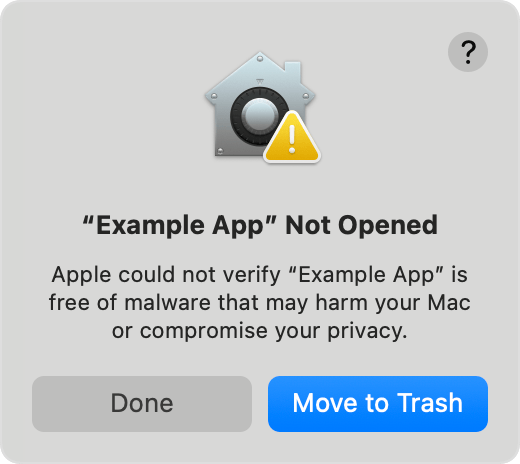

# Atoma Compute desktop

Atoma Compute is a companion for macOS (Apple Silicon and Intel) and Windows x64.
It runs the existing Compute client in a separate process, with Node embedded.
Docker Desktop remains an explicit prerequisite; use its WSL2 backend on Windows.

Connect your account in the application and confirm the organisation in your
browser. Choose **Prepare and connect** to download the pinned components, check
Docker and connect. In Atoma project settings, explicitly allow and select this
computer. The application never grants itself project access.

An existing terminal-client pairing is reused. Run only one client on a computer:
stop the terminal client before connecting the desktop application.

The four views show connection, diagnostics, activity and resources. Closing the
window keeps it running in the menu bar/system tray. Quitting stops local work;
it waits for engine confirmation and refuses to claim success when Docker cannot
confirm teardown. A disconnected run requires explicit recovery in Atoma.

## Installing the unsigned macOS beta

**Atoma Compute is not yet signed with an Apple Developer ID certificate or
notarized by Apple.** macOS may block its first launch. Download the beta only
from [Atoma’s installation page](https://atoma.run/compute/setup), choosing
Apple Silicon or Intel to match your Mac. Approve an exception only if you trust
the download; it does not mean Apple has verified the app.

1. Open the `.dmg`, drag Atoma Compute to **Applications**, and open it there.
2. If macOS cannot verify the app, dismiss the alert with **Done** or **Cancel**.
   Do not choose **Move to Trash**.
3. Open **System Settings → Privacy & Security**, scroll to **Security**, and
   choose **Open Anyway** beside **Atoma Compute**.
4. Authenticate if requested and confirm **Open**.

These are Apple’s example screenshots, showing “Example App”. Look for
**Atoma Compute** on your Mac; wording varies by macOS version and language.
Click either screenshot to inspect it at full size.




Source: [Apple Support — Safely open apps on your Mac](https://support.apple.com/102445).

If **Open Anyway** is missing, try launching the app again before returning to
settings. A managed Mac may require your administrator’s approval. Stop if macOS
reports malware or says the app will damage your computer. For a damaged-app
warning, download again from Atoma and contact support if it persists. Do not
disable Gatekeeper or remove quarantine protection with Terminal commands.

Beta updates require a manual download and installation; macOS may ask for
approval again. Once the app opens, continue with Docker setup and account pairing.

## Resource limits

Resources shows Docker's available capacity separately from Atoma's assigned
budget. Expand **Resources assigned to Atoma** to change the CPU and memory
limits, or restore the recommended values. Save applies the choice to subsequent
run assignments, including after restarting the app. Existing runs keep their
original limits; saving does not stop or restart them.

The recommendation uses about 70% of Docker CPUs and 60% of Docker memory,
leaving at least two CPUs and 2 GiB when capacity permits. The minimum supported
budget is 5 CPUs and 6 GiB. Limits cannot exceed Docker's available capacity;
if Docker capacity shrinks below a saved budget, lower it before the next run.
The app never changes Docker Desktop's own settings.

The budget includes tools/builds, document search, workspace control, network
proxies and one preview. These are ceilings, not reserved or continuously busy
CPU cores. Model calls still execute through Atoma, and sequential work cannot
use every available CPU. The resource editor shows the current run's budget
separately when a saved change is waiting for the next run.

## Build and distribution

Use the pinned Node version and `npm ci`, then:

```sh
npm run compute:desktop:build
npm run compute:desktop
npm run compute:desktop:package
```

The application bundle is `dist/compute-desktop`; installers are written under
`dist/compute-installers`. Node is embedded, and product databases, local
credentials and workspaces are not included. No Electron native-module rebuild
is needed: the local inventory uses embedded Node's SQLite implementation.

The **Compute desktop** workflow first builds the application and compares its
content with the last published version. The comparison covers all bundled files
(including shared imports and bundled dependencies), Electron, the installer
configuration and its locked dependency tree. Unrelated server, web, documentation
or dependency changes do not publish an application update. The generated CI
version suffix is excluded from this comparison; an authored version change is
included. Existing releases without a content receipt are compared by rebuilding
the exact source revision recorded in their release notes.

When the content differs, native jobs build and test macOS arm64, macOS x64 and
Windows x64 in parallel with the main CI. Each native bundle must match the
content decision. Once both pass for the same source revision, the workflow
publishes an immutable release with a `compute-desktop-content.json` receipt and
updates the public `compute-desktop-current` download channel. Stable download
filenames (`Atoma-Compute-mac-arm64.dmg`, `Atoma-Compute-mac-x64.dmg`, and
`Atoma-Compute-win-x64.exe`) and their checksums always point to that
publication; versioned files remain available for release history. Without publisher
credentials the channel contains unsigned preview installers; native Docker/run
acceptance remains separate and requires Docker Desktop on the target machine.

Release titles show the installer version. Each release starts with direct links
for Mac Apple Silicon, Mac Intel and Windows x64, plus installation instructions.
Use the [current downloads](https://github.com/atoma-run/atoma/releases/tag/compute-desktop-current)
for the latest published version; historical releases retain their exact versioned
links. Checksums and GitHub source archives are not application installers.

Stable builds require Developer ID signing/notarization on macOS and a Windows
code-signing certificate. Configure `ATOMA_MAC_CSC_LINK`,
`ATOMA_MAC_CSC_PASSWORD`, `ATOMA_WINDOWS_CSC_LINK`,
`ATOMA_WINDOWS_CSC_PASSWORD`, `ATOMA_APPLE_API_KEY`, `ATOMA_APPLE_API_KEY_ID`
and `ATOMA_APPLE_API_ISSUER` as CI secrets. The Apple API key secret contains the private `.p8` key; the workflow provisions
it as a private temporary file for notarization and removes it afterward.
Never commit certificates, passwords or API keys.

When all signing and notarization secrets are configured, application changes on
main build signed installers and automatically update both
`compute-desktop-stable` and the public download channel after CI succeeds. A manual `workflow_dispatch` can
still request a preview or a signed publication. Each architecture has its own
update manifest. Signed applications check at startup, every four hours, and
after waking from sleep. When an update is available, **Update and restart**
downloads it, pauses new run assignments and waits for current work and transfers
to finish. Installation follows a fresh local check and confirmed workload
teardown; it never interrupts an active run. Keep the application open while
waiting. **Postpone update** cancels the pending installation and leaves new
runs paused; enable them again in Activity when ready. Account pairing and
resource settings are kept. Resources also offers a manual update check.
Unsigned previews explain that a manual download is required and link to releases.

CI adds its workflow run number to the package patch version for the native
installer (for example, `0.4.0` with run 42 becomes `0.4.42`). All architectures
share that version; metadata-only version suffixes cannot establish update order.
Local builds retain the package version unless `ATOMA_COMPUTE_BUILD_NUMBER` is
set. Before publishing any installer, including an unsigned preview, approve its
exact installer version in the server's `ATOMA_COMPUTE_APP_VERSIONS` allowlist. Retain earlier supported
versions during rollout; installing a new version never bypasses server admission.
Publishing to GitHub does not update that operator-owned configuration. Activate
the approved configuration through the normal deployment path, then verify the
loaded version policy in both the web process and selected executor. A connected
computer alone does not establish that its installer version can execute runs.

```sh
node scripts/compute-desktop-smoke.mjs
```

This smoke drives the real Electron sandbox and IPC with an isolated fake runtime;
it never pairs an account or starts a paid project run.

## Guided setup

`/compute/setup` opens the app-download view by default; `mode=manual` retains
the verified terminal installation instructions. Browser hints suggest a system,
with explicit overrides. A Mac browser does not reliably identify the physical
chip: users select Apple Silicon or Intel using About This Mac.

The utility process checks the native OS, Docker Desktop and Windows WSL2.
The app can download and open the fixed official Docker installer after verifying
its publisher, or start an installed Docker application. The installer retains
license acceptance and OS authorization. On Windows, a separate explicit action
opens the elevated WSL installation/update prompt; disabled firmware virtualization
requires the manufacturer's instructions. Preparation waits for Docker readiness
before image pulls. Pending preparation survives reopening; Cancel clears it.
It does not resume a run or replay an indeterminate command.

Preview installers are separate from the signed stable feed and carry an explicit
notice about platform installation blocks. The native release workflow can publish
an immutable preview after all three platform jobs pass. Real Docker installation,
WSL reboot and license flows still require manual platform acceptance testing.

The content comparison runs alongside Atoma CI on main pushes and pull requests;
native validation runs when the application content differs. Pull requests
produce CI artifacts only. Manual dispatch always permits native validation,
but publication still requires changed content. Main pushes update the release
channel only after the full CI for that exact revision succeeds. Publication is
serialized and rechecks the current channel: identical content is skipped, and
an older build cannot replace a newer published revision. Later unrelated
commits do not invalidate an application's installer. A failed publication is
retried by a subsequent push while its application content remains unpublished.
